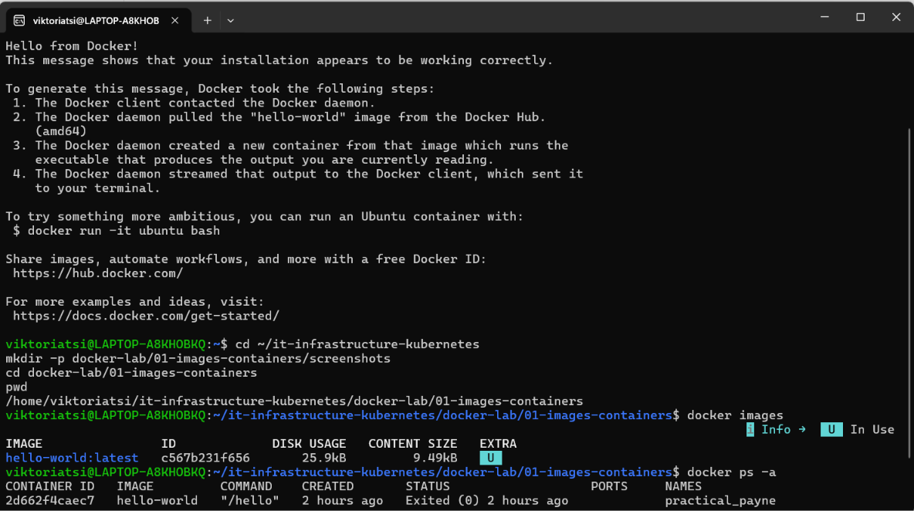
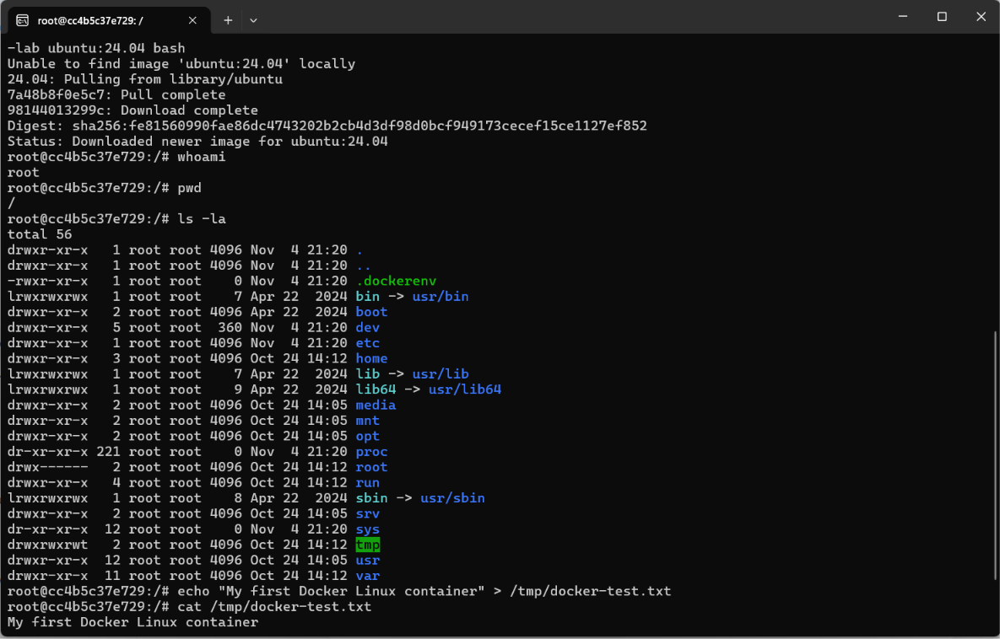
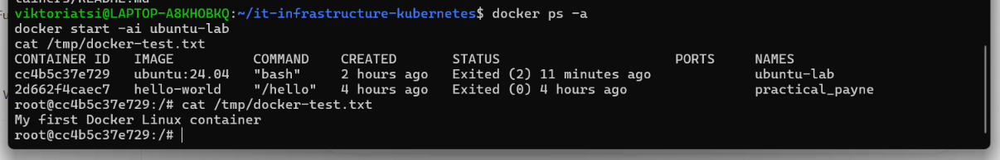

# Docker Lab 01 — Images and Containers

## Objective
Learn Docker fundamentals by running and managing an Ubuntu Linux container through Docker Desktop and WSL 2.

## Environment
- Windows with Ubuntu WSL 2
- Docker Desktop with WSL integration
- Ubuntu 24.04 Docker image
- Bash terminal

## Practical Tasks

### 1. Verify Docker installation
~~~bash
docker --version
docker run hello-world
~~~
**Result:** Docker successfully downloaded and ran the `hello-world` container.

### 2. Inspect images and containers
~~~bash
docker images
docker ps -a
~~~
**Result:** Listed downloaded images and containers, including stopped containers.

### 3. Run an Ubuntu Linux container
~~~bash
docker run -it --name ubuntu-lab ubuntu:24.04 bash
whoami
pwd
ls -la
cat /etc/os-release
~~~
**Result:** Started an interactive Ubuntu 24.04 container and explored its Linux environment.

### 4. Create a file inside the container
~~~bash
echo "My first Docker Linux container" > /tmp/docker-test.txt
cat /tmp/docker-test.txt
~~~
**Result:** Created and read a text file inside the container.

### 5. Test the container lifecycle
~~~bash
exit
docker ps -a
docker start -ai ubuntu-lab
cat /tmp/docker-test.txt
~~~
**Result:** The file was still available after stopping and restarting the same container.

## Troubleshooting
Initially, Docker returned a `permission denied` error when accessing the Docker API socket. Enabling Ubuntu in Docker Desktop's WSL Integration settings resolved the issue. The `hello-world` test then succeeded.

## Key Learnings
- A Docker image is a template used to create containers.
- A Docker container is a runnable instance of an image.
- `docker ps -a` lists running and stopped containers.
- Files in a container's writable layer survive a stop/restart of that same container.
- Removing a container also removes its writable layer; Docker volumes or bind mounts can provide storage that outlives a container.

## Status
Completed — practical commands and results verified.
